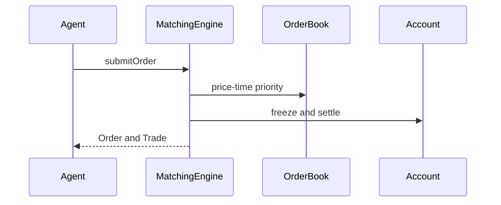

# Multi-Agent Continuous Auction Stock Trading Simulator

本项目根据《Introduction to Java Programming》课程项目要求实现，定位为 Java 初学者可以读懂和答辩的连续竞价股票交易模拟器。项目采用 Java 11、Maven、JavaFX、JUnit 5 和 Gson。

## 运行

首次使用 Maven 时需要联网下载依赖。项目自带 Maven 在 `.tools/apache-maven-3.9.9/bin/mvn`：

```bash
.tools/apache-maven-3.9.9/bin/mvn test
.tools/apache-maven-3.9.9/bin/mvn javafx:run
```

也可以运行无界面的固定演示：

```bash
.tools/apache-maven-3.9.9/bin/mvn exec:java
```

演示结束会在 `output/` 写出 `orders.csv`、`trades.csv` 和 `ranking.csv`。

## 已实现功能

- LIMIT 和 MARKET 订单
- 多股票独立订单簿
- 价格优先、时间优先撮合
- 资金和持仓冻结，防止重复挂单导致超买或超卖
- 账户权益、收益率、成交量、最大回撤
- `synchronized` 撮合引擎和线程安全账户快照
- JavaFX 下单、撤单、五档深度、价格趋势、订单历史和排名
- AI Trader 定时线程；LLM API 为可选功能，失败时 HOLD
- UTF-8 CSV 持久化
- JUnit 5 测试和 JavaDoc

## 目录

- `src/main/java/com/example/trading/engine`：连续竞价核心
- `src/main/java/com/example/trading/model`：订单、成交、账户模型
- `src/main/java/com/example/trading/agent`：模拟调度和可选 LLM 策略
- `src/main/java/com/example/trading/app`：JavaFX 界面、配置、CSV 导出
- `docs/strategy-analysis.md`：人工策略与自动策略分析
- `src/main/resources/config.properties`：人数、股票、速度和 LLM 配置

## 设计流程



详细的策略分析、GitHub PR 复核建议和后续扩展方向见 `docs/strategy-analysis.md`。

## GitHub 提交建议

课程要求所有实现通过 Pull Request 审查。建议提交顺序为：`core-engine`、`account-and-csv`、`javafx-ui`、`ai-strategy`，每个 PR 在描述中标记 AI 辅助代码，并让组员检查撮合线程安全、异常处理和边界条件后再合并。
